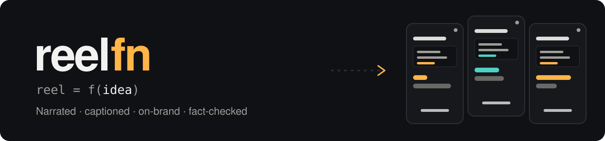
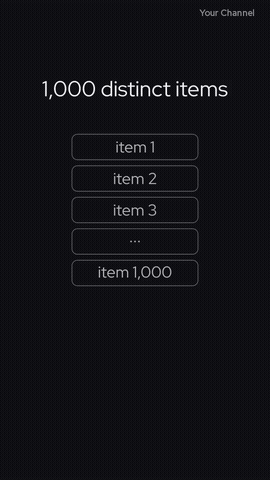
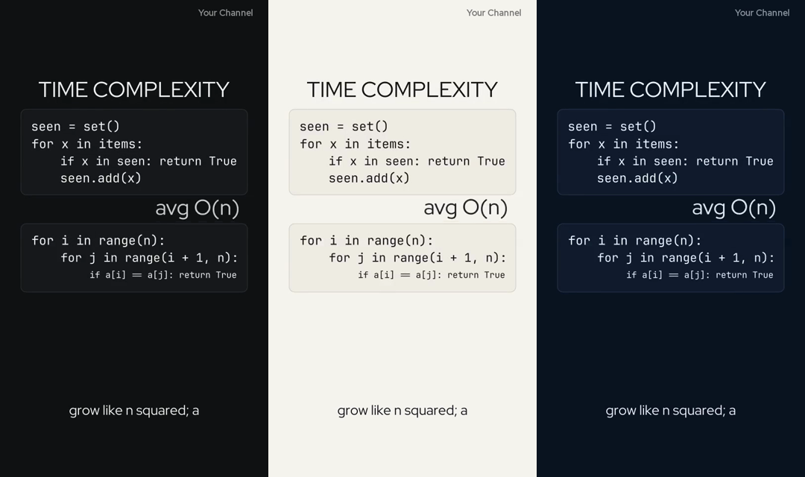

<div align="center">

<picture>
  <source media="(prefers-color-scheme: dark)" srcset="docs/assets/banner-dark.svg">
  <source media="(prefers-color-scheme: light)" srcset="docs/assets/banner-light.svg">
  
</picture>

### Your reel, as a function of an idea.

Ask your AI agent for a video. Get a narrated, captioned, on-brand **Reel**, **Short** or **TikTok**,<br>
made with code instead of a video model, with editable scenes and deterministic checks for the numbers recorded in each episode.

[](LICENSE)
[](CHANGELOG.md)
[](#quick-start)
[](https://nodejs.org)
[](https://www.python.org)
[](CONTRIBUTING.md)

**[Quick start](#quick-start)** · **[Make it yours](#make-it-yours)** · **[Without an agent](#without-an-agent)** · **[How it works](#how-it-works)** · **[Contributing](#contributing)**

</div>

<br>

<table>
<tr>
<td width="290" valign="top">

</td>
<td valign="top">

### You say

> *"Make a 45-second reel about why the sky is blue."*

### Your AI agent

1. **Asks** only what you must decide: angle, length, tone.
2. **Researches** real sources and quotes them word for word.
3. **Writes** a script whose every number is recomputed by a validator.
4. **Voices** it with a natural narrator, then **animates** in time with the voice.
5. **Builds** the video with captions, music and *your* logo, colours and font.
6. **Reviews** the frames and hands you the MP4, plus caption, hashtags and alt text.

Nothing is ever posted for you. You approve the script and the final video.

</td>
</tr>
</table>

## ✨ Why reelfn

| | |
| :-- | :-- |
| 🎨 **Your brand, not ours** | Your name, logo, colours, font and narrator voice. Three built-in themes, or design your own. |
| ✅ **Facts that are checked** | Sources are quoted verbatim, and numbers are recomputed before anything renders. |
| 🗣️ **Voice first** | Narration is generated and measured first, so animation lands exactly on the spoken words. |
| 🧑‍🤝‍🧑 **Made for non-coders** | Talk to an AI agent in plain words; it runs every command and explains every fix. |
| 💻 **Any computer** | Windows, macOS and Linux on a modest laptop. No GPU, no cloud render farm. |
| 💸 **Voice options** | MIT-licensed code, with Gemini narration, an optional offline voice, or a silent preview. Provider pricing and quotas apply. |

<div align="center">

<br>
<sub>One reel, three built-in themes: <code>midnight</code> · <code>paper</code> · <code>ocean</code>. Or bring your own.</sub>
</div>

<a id="quick-start"></a>

## 🚀 Quick start

### 1 · Install the basics (once)

You need **Node.js 22+**, **Python 3.12** (3.11 to 3.13 work), **FFmpeg** and **Git**. Copy the lines for your system
into a terminal.

<details open>
<summary><b>🪟 Windows</b> (PowerShell)</summary>
<br>

```powershell
winget install OpenJS.NodeJS.LTS
winget install Python.Python.3.12
winget install Gyan.FFmpeg
winget install Git.Git
```

Close the terminal and open a new one afterwards, so it can find the new programs.
</details>

<details>
<summary><b>🍎 macOS</b> (with <a href="https://brew.sh">Homebrew</a>)</summary>
<br>

```bash
brew install node python@3.12 ffmpeg git pkg-config cairo pango
```
</details>

<details>
<summary><b>🐧 Linux</b> (Ubuntu / Debian)</summary>
<br>

```bash
sudo apt install python3.12 python3.12-venv python3.12-dev ffmpeg git build-essential pkg-config libcairo2-dev libpango1.0-dev
```

Then install Node.js 22 or newer from [nodejs.org](https://nodejs.org/en/download), because many distributions ship an older one.
Fedora: `sudo dnf install python3.12-devel ffmpeg git cairo-devel pango-devel`.
</details>

### 2 · Get reelfn and set it up

```bash
git clone https://github.com/thekusaldarshana/reelfn.git
cd reelfn
npm run setup
```

Setup takes 5 to 10 minutes the first time and ends with a checklist. Any line marked `FAIL` tells you the exact
command that fixes it. No Git? Use **Code → Download ZIP** above, unzip it, and open a terminal in that folder.

> [!TIP]
> **See it work right away**, with no account or key: this builds a complete example with a silent placeholder voice.
> ```bash
> npm run reel -- build time-complexity-loops --voice placeholder
> ```
> Your video appears in `output/time-complexity-loops/`.

### 3 · Make your own reel with an AI agent

Open the `reelfn` folder in your AI coding agent and just ask:

> *Set up my brand, then make a 45-second reel about why the sky is blue.*

reelfn ships instructions for these agents, so they know the whole workflow:

| Agent | How to start |
| :-- | :-- |
| [**Claude Code**](https://claude.com/claude-code) | Run `claude` in the folder (or open it in the desktop app or VS Code). Type `/reelfn` or just ask. |
| [**Codex**](https://openai.com/codex/) | Run `codex` in the folder, or open it in the Codex app. |
| [**Cursor**](https://cursor.com) | Open the folder and ask in the agent chat. |
| [**Gemini CLI**](https://github.com/google-gemini/gemini-cli) | Run `gemini` in the folder. |
| Any other agent | Point it at [`AGENTS.md`](AGENTS.md). |

The first time, the agent asks for your channel name, look, logo and voice. It also helps you add a **Gemini API
key** for the narrator: get one at [aistudio.google.com/apikey](https://aistudio.google.com/apikey) and paste it into
the `.env` file in the reelfn folder.

> [!IMPORTANT]
> Never paste API keys into a chat. Keys belong in your local `.env` file, which is git-ignored. Keep that file out of uploads, archives, and commits.

<a id="make-it-yours"></a>

## 🎨 Make it yours

Your personal brand file and assets live in `brand/` and are git-ignored. Keep them out of commits and shared archives.

```bash
npm run reel -- brand init   # creates brand/brand.json from an example
npm run reel -- brand        # shows what your videos will use
```

```jsonc
// brand/brand.json: every setting is optional
{
  "name": "Science Corner",                 // text watermark and end card if you have no logo
  "hashtag": "#sciencecorner",
  "theme": "paper",                         // midnight, paper, ocean, or your own
  "colors": { "accent": "#FF5A5F" },        // override any single colour
  "endCard": { "seconds": 2 },
  "voice": { "voice": "Kore", "language": "en-US", "style": "Calm, warm and precise." },
  "editorial": { "audience": "High-school students", "tone": "Friendly and exact." }
}
```

Drop `logo.png` (end card) and `watermark.png` (corner mark) into `brand/assets/`. Full guide: **[brand/README.md](brand/README.md)**.

<a id="without-an-agent"></a>

## ⌨️ Without an AI agent

Everything the agent does is a plain command you can run yourself:

```bash
npm run reel -- new black-holes        # creates reels/black-holes/ (script, scene, post copy)
npm run reel -- validate black-holes   # checks the script, timeline, sources and every number
npm run reel -- build black-holes      # voice, music, captions, animation, final MP4
npm run reel -- frames black-holes     # a contact sheet of frames to review
npm run reel -- help                   # every command and option
```

Each reel is a folder with three files:

```text
reels/black-holes/
├── episode.json   the script: beats, narration, sources and checked claims
├── scene.py       the animation, written with Manim and reelfn's helpers
└── release.md     caption, hashtags and alt text for posting
```

Start from the two complete reels in [`examples/`](examples/), and read the [agent skill](skills/reelfn/SKILL.md) for
the full production method. It is written for agents, but people can follow it too.

<details>
<summary><b>🗣️ Narrator options</b></summary>
<br>

| Voice | Good for | Needs |
| :-- | :-- | :-- |
| `gemini` (default) | Natural, expressive narration in many languages | A Gemini API key with access to the configured TTS model; provider pricing and quotas apply |
| `kokoro` | Fully offline narration (experimental) | `npm run setup -- --local-voice` and a model download; see [MODELS.md](renderer/audio/MODELS.md) |
| `placeholder` | Trying things out, timing drafts | Nothing: it is silent |

Pick one per run with `--voice <name>`, or set it in `brand/brand.json`.
</details>

<a id="how-it-works"></a>

## ⚙️ How it works

```text
idea ─▶ research ─▶ episode.json ──validate──▶ voice ─▶ mix ─▶ captions ─┐
                                                                          ├─▶ assemble ─▶ your-reel.mp4
                    scene.py ───────────────────────────────render───────┘
```

Animation is [Manim](https://www.manim.community/), the engine behind many maths explainers. Assembly is
[FFmpeg](https://ffmpeg.org/). Music and sound cues are generated in code, so there are no samples to license. Assembly writes a manifest of SHA-256 hashes for the recorded inputs and outputs, so you can trace a build.
Details: **[docs/how-it-works.md](docs/how-it-works.md)**.

## 🩺 Troubleshooting

| Problem | Fix |
| :-- | :-- |
| A line says `FAIL` or "not found" | Run `npm run doctor`. It checks everything and prints the fix for your system. |
| "Gemini daily free-tier quota is exhausted" | Check your account and model quota in Google AI Studio. Wait for a reset, keep working with `--voice placeholder`, or use a paid key. Unchanged beats are cached and never re-voiced. |
| Text looks wrong or overlaps | Run `npm run reel -- frames <name>`, look at the sheet, and ask your agent to fix the layout. |

More answers: [troubleshooting guide](skills/reelfn/references/troubleshooting.md). Still stuck?
[Open an issue](https://github.com/thekusaldarshana/reelfn/issues/new/choose) with the output of `npm run doctor`.

## 🛡️ Responsible use

reelfn helps you make accurate videos, but you are the one who publishes them. Check the facts, the voice and the
rights before you post, follow your narrator provider's terms, and label AI narration where your platform asks you to.

## 🗺️ Roadmap

- [ ] One-command install with `npx reelfn`
- [ ] More voice providers (OpenAI, ElevenLabs, Azure, Piper)
- [ ] Square and landscape formats, 1080p output
- [ ] A browser-based studio for reviewing and approving videos
- [ ] A library of reusable scene components: graphs, maps, timelines, equations

Ideas and votes welcome in [issues](https://github.com/thekusaldarshana/reelfn/issues).

<a id="contributing"></a>

## 🤝 Contributing

Contributions of every size are welcome: new themes, example reels, fact-check types, docs, and testing on your
computer. Start with **[CONTRIBUTING.md](CONTRIBUTING.md)**. Please follow the [Code of Conduct](CODE_OF_CONDUCT.md),
and report security issues privately ([SECURITY.md](SECURITY.md)).

## 📄 License

[MIT](LICENSE). Bundled fonts are under the SIL Open Font License; see [THIRD_PARTY_NOTICES.md](THIRD_PARTY_NOTICES.md).

<div align="center">
<br>
<sub>Made with Manim, FFmpeg and a lot of checked numbers.</sub>
</div>
